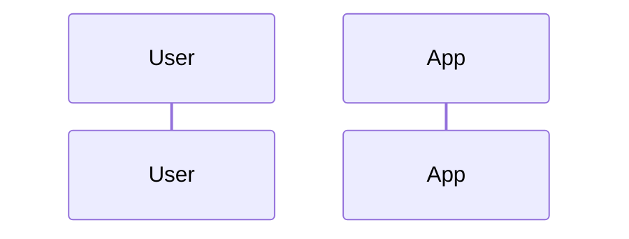

## Summary

<!-- One or two sentences: what changes for someone using Simpanin, or for someone working on it. -->

## Problem

<!-- What was wrong or missing, and who it affected. -->

## How to reproduce

<!-- Steps on main that show the problem, or "not applicable". -->

## Approach and why

<!-- The options you weighed and why this one. -->

## Changes

<!-- One line per commit or per part, in the order they're in. -->

## Screenshots or recording

<!-- Before and after for anything on screen. Synthetic data only, never a real document. -->

## Flow

<!-- For a change in logic: a Mermaid diagram of the order of events, or "not applicable".

-->

## Tests

<!-- What you ran and the counts you saw; the new tests and that each failed first. -->

## On a device

<!-- What was checked on an iPhone, and what wasn't. -->

## Risk

<!-- What could break, for whom, and how you'd notice. -->

## Checklist

- [ ] The hooks ran on every commit (none skipped)
- [ ] CODING.md section 13, "Before you commit"
- [ ] No real document data in code, tests, screenshots or this description
- [ ] Docs updated where the change affects them (README, CONTRIBUTING, CODING)

## Out of scope

<!-- What this pull request leaves for later, and where it's noted. -->
