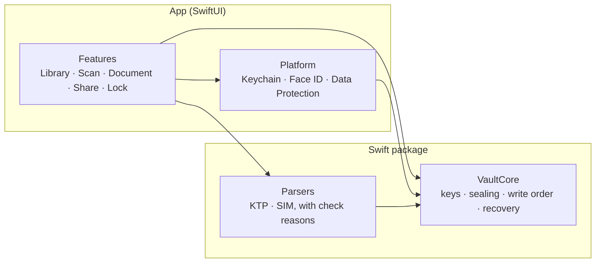

# Simpanin

[](https://github.com/nezdecode/Simpanin/actions/workflows/checks.yml)

A privacy-first iOS app for keeping identity documents such as KTP and SIM. Documents are scanned, read and encrypted on the phone, and open only with Face ID or the device passcode. No account, no server, no analytics.

**Status:** in development. Not yet on the App Store.

<!-- Preview: 3 or 4 screenshots with synthetic data only (a "CONTOH" card, NIK starting with 00).
     Upload them by dragging into this file in GitHub's web editor, so they live on GitHub's CDN and not in the repository. -->
| Documents | Checking a scan | A document | Locked | Share watermarked documents |
| :-: | :-: | :-: | :-: | :-: |
|  |  |  |  |  |

## Why

In Indonesia, a photo of your KTP is asked for everywhere: renting a room, opening an account, starting a job. Those photos pile up in the camera roll, sync to the cloud and get forwarded in chats, where they can be reused for loans in your name. Simpanin keeps the documents encrypted on the phone and, when one has to be sent, shares a copy marked with what it's for and the date.

## What works today
 
- **An encrypted vault**, locked with Face ID or the device passcode, with auto-lock and a cover that hides documents in the app switcher and during screen recording.
- **Adding documents**: scan a KTP or SIM with the document camera, or pick a photo from Photos. Text is read on the phone with Apple's Vision framework, and the user checks every field before saving.
- **Checks while saving**: fields that may be misread are marked with a reason, a document already in the vault is flagged, and pages from different documents in one scan are pointed out.
- **The document screen**: the number stays masked until tapped, a copied number leaves the clipboard after 60 seconds and never syncs to other devices, and pages open full screen.
- **Editing a document**: fill in or correct a saved document's label, fields and expiry. A wrong value is refused, and a changed number is checked against the documents already in the vault.
- **Sharing a marked copy**: every page carries the purpose and date across it; the stored document never changes, and the copies are deleted once shared.
- **Recently deleted**: documents are kept for 30 days before they're purged.

## Roadmap
 
Planned, some in the works now and some for later. The order can change; nothing here is promised by a date.
 
- Full editing (type and pages)
- Expiry reminders
- Reading passports and STNK
- English
- An accessibility pass
- More options for the shared copy's mark
- Import from Files

## How documents are protected
 
- Each document has its own key. Its pages and fields are sealed with AES-256-GCM.
- The document keys are wrapped by a vault key in the Keychain, usable only on this device, only while it's unlocked, and only after Face ID or the passcode.
- Every file uses iOS Data Protection (class Complete), so nothing can be read while the phone is locked.
- Decrypted data stays in memory only while the screen showing it is open, and never touches the disk.
- There is no sync and no backup of the vault key: a document stays on the phone it was saved on.

## Engineering
 


- **VaultCore** is a Swift package that imports only Foundation and swift-crypto. Its writes go through a fixed order (temp file, protection class, rename), and it recovers from a missing or stale index. It's tested on a Mac and on Linux, without a simulator, including fixture vaults that must always open.
- **Parsers** turn recognised text into fields and say why a field needs checking (a lookalike digit, a NIK that disagrees with the birth date, an expiry that isn't plausible). They're tested on synthetic text only.
- **The app** is organised by feature, with one model per screen and decisions as pure functions. Folder rules and privacy rules are checked by SwiftLint and the commit hooks.
- **Every change** is planned with its edge cases first, built test first, checked with deliberate mutations, reviewed, and tried on a real iPhone before it's merged. Pull requests run the commit checks, swift-format, SwiftLint and the VaultCore tests on Linux.

## Privacy
 
- No network calls, no analytics, no crash reporting, no third-party SDKs. A document leaves the phone only as a marked copy you share yourself through the share sheet. The only dependency is Apple's [swift-crypto](https://github.com/apple/swift-crypto).
- Real document scans are never part of this repository. Tests use synthetic data only, with test NIKs starting with 00.

## Development

Read [CONTRIBUTING.md](CONTRIBUTING.md) first: setup, the privacy rules and the pull request process. [CODING.md](CODING.md) covers how code is written.

Run the core tests on a Mac (no simulator needed):

```sh
cd Packages/VaultCore && swift test
```

Build the app (Xcode 27; the app runs on iOS 26 or later):

```sh
xcodebuild -project Simpanin.xcodeproj -scheme Simpanin -destination 'generic/platform=iOS Simulator' build
```

## Reporting a security issue

Please don't open a public issue. Use GitHub's private vulnerability reporting: the **Security** tab, then **Report a vulnerability**.

## License

The code is licensed under the Mozilla Public License 2.0 (MPL-2.0); see [LICENSE](LICENSE).

## Trademarks

The Simpanin name and icon are not licensed under MPL-2.0 and may not be used for derived apps.
